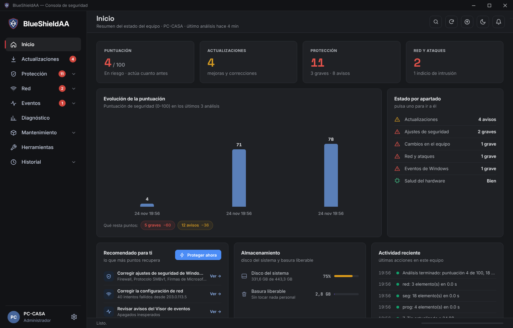
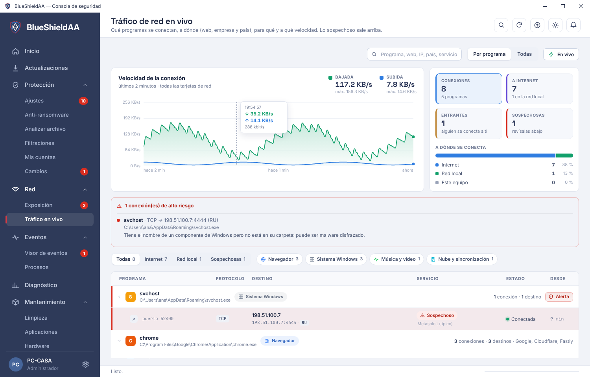
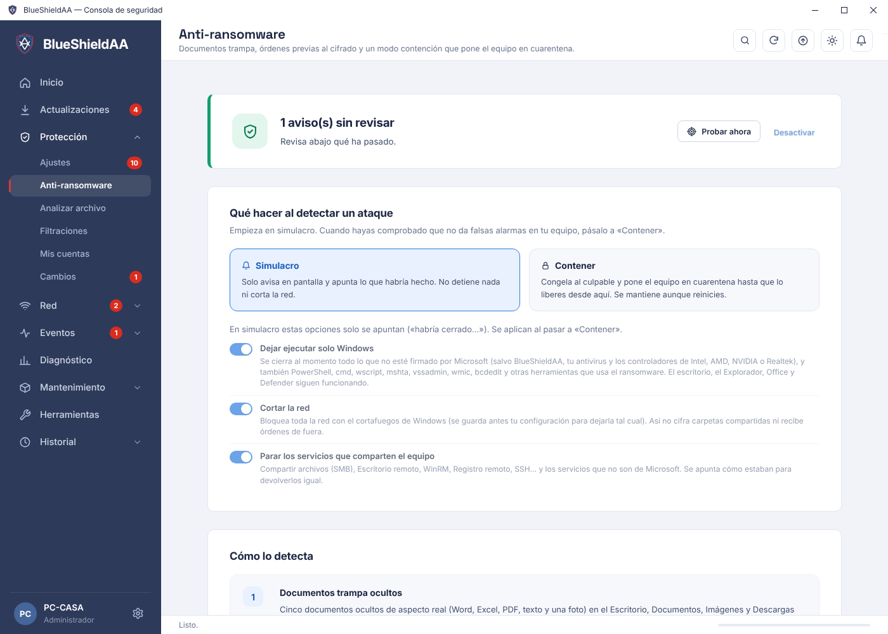
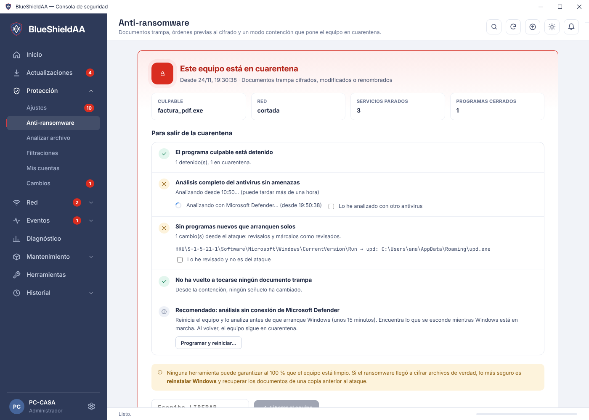
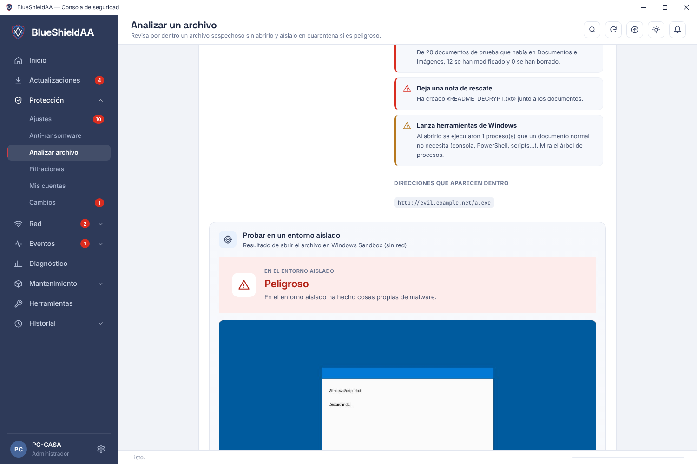
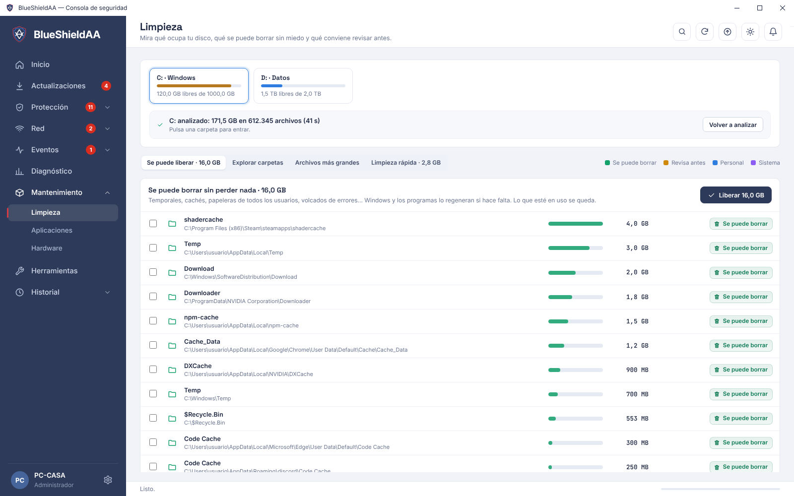
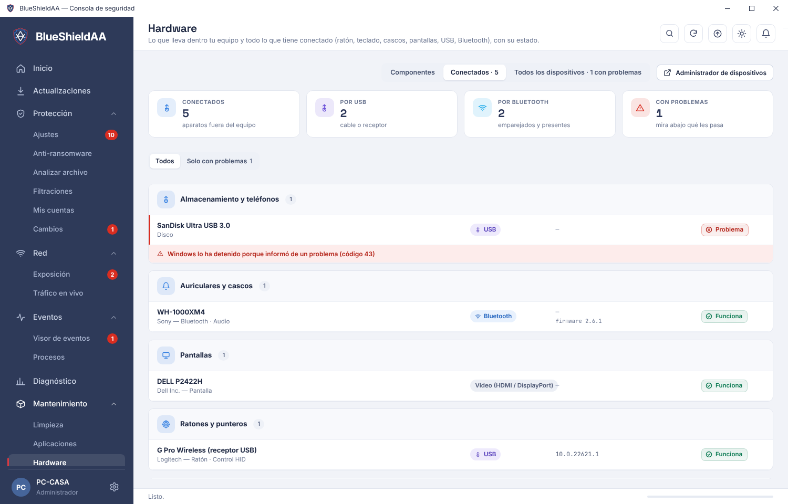
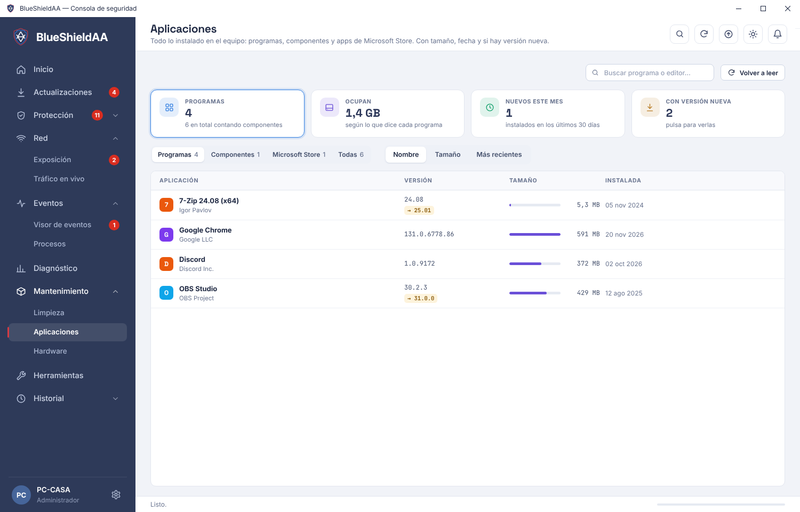
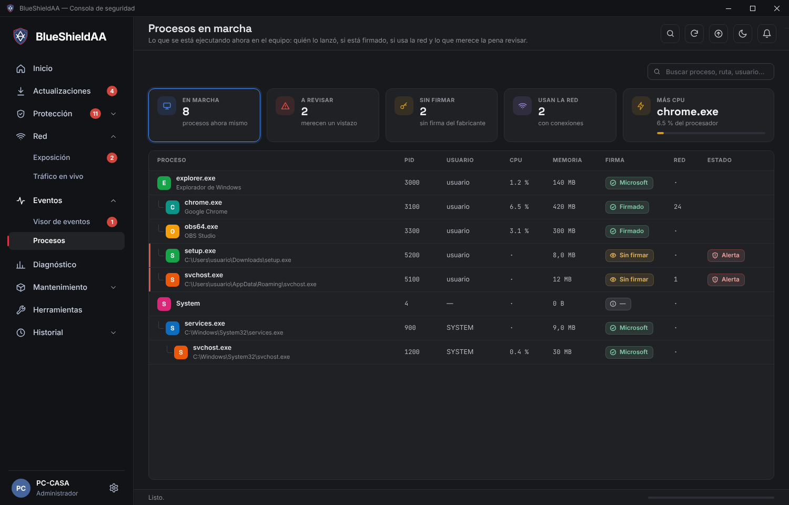

# 🛡️ BlueShieldAA

**Consola de seguridad para Windows 10/11 pensada para el día a día.** Desde un solo sitio mantiene el equipo actualizado, vigila la red y los procesos, protege contra el ransomware y ayuda a liberar espacio. Todo se hace en local: sin cuentas, sin servicios en la nube y sin pedir contraseñas ni claves.

> ⚠️ **Proyecto en beta y todavía sin firma digital.** Windows SmartScreen o tu antivirus pueden avisar al descargarlo o al ejecutarlo. El código está aquí para que puedas revisarlo y compilarlo tú mismo.



## Qué hace

| Apartado | Qué hace |
|---|---|
| **Actualizaciones** | Busca e instala versiones nuevas de los programas (winget) y parches de Windows. Crea un punto de restauración antes y comprueba que la versión nueva quedó instalada. |
| **Ajustes de seguridad** | Revisa el cortafuegos, Defender, SMBv1, UAC, BitLocker, Secure Boot… y corrige lo que esté mal con un clic. |
| **Anti-ransomware** | Pone documentos trampa ocultos y corta las órdenes que lanza el ransomware antes de cifrar. Tiene un **modo contención** que congela al culpable, deja ejecutar solo Windows, corta la red y para los servicios que comparten el equipo hasta que lo liberes con una lista de comprobación. Empieza en modo simulacro. |
| **Analizar archivo** | Analiza un archivo por dentro sin abrirlo y consulta bases de malware gratuitas. Opcionalmente lo abre en **Windows Sandbox** sin red, como ANY.RUN, con capturas, procesos y archivos creados. |
| **Tráfico en vivo** | Gráfica de bajada y subida. Muestra qué programa se conecta, a qué web, empresa y país, para qué servicio, si la conexión es entrante o saliente, y destaca lo sospechoso. |
| **Procesos** | Árbol de procesos con firma digital, uso de red y CPU, y avisos de lo que no encaja. |
| **Mis cuentas** | Cuentas de Google, Microsoft y otras que hay en el equipo, con acceso directo a su actividad, dispositivos y ubicación. También muestra los inicios de sesión en el propio PC. |
| **Limpieza** | Explorador del disco al estilo SpaceSniffer/WizTree, con lo que se puede borrar sin miedo, lo que conviene revisar antes y limpieza rápida. |
| **Aplicaciones** | Todo lo instalado (programas, componentes y Microsoft Store) con tamaño, fecha, versión nueva y desinstalar. |
| **Hardware** | Componentes del equipo con su salud y todos los dispositivos conectados (ratón, cascos, pantallas, USB, Bluetooth) con su estado, controlador y firmware. |
| **Diagnóstico** | CPU por núcleo, memoria, disco y red en tiempo real. |

## Capturas

| | |
|---|---|
|  |  |
|  |  |
|  |  |
|  |  |

*Las capturas usan datos de ejemplo.*

## Descarga

En [**Releases**](../../releases) tienes:
- **Instalador** (`BlueShieldAA-x.y.z-Instalador.zip`): instala en *Archivos de programa*. Es la única versión con el guardián anti-ransomware.
- **Portable** (`BlueShieldAA-x.y.z-Portable.zip`): se descomprime y se ejecuta; guarda sus datos en su propia carpeta.

**Requisitos:** Windows 10 u 11 de 64 bits, [WebView2 Runtime](https://developer.microsoft.com/microsoft-edge/webview2/) (viene con Windows 11) y permisos de administrador.

## Privacidad

- No hay cuentas, telemetría ni servidor propio.
- Las únicas consultas a Internet son a servicios públicos y gratuitos que no piden clave: winget, Team Cymru (dueño y país de una IP, por DNS), AlienVault OTX, CIRCL hashlookup, XposedOrNot, Have I Been Pwned (contraseñas por k-anonimato, nunca la contraseña) y CISA KEV.
- Las reglas de análisis están en `reglas-analisis.json`, en texto plano, para que cualquiera las revise.

## Cómo está hecho

- **Go** (nativo, sin CGO) + **WebView2** para la interfaz, que es un único `index.html` incrustado en el ejecutable.
- APIs nativas de Windows (IP Helper, Toolhelp, SetupAPI, SCM, PDH, WinVerifyTrust…) en lugar de PowerShell siempre que se puede.
- Se compila desde Linux con cross-compiling e instalador NSIS.

```
build/              Parches de la interfaz (p01…p19.py), estilos (new.css) y fuentes
orig/               Interfaz base sobre la que se aplican los parches
src/native/app/     Código Go (motor, analizadores, guardián, Windows)
src/native/third_party/  Dependencias incluidas (go-webview2, golang.org/x/sys)
src/exe/            Instalador NSIS
```

### Compilar

Requisitos (Linux): Go 1.24+, Python 3, `binutils-mingw-w64` (windres) y `nsis` (makensis).

```bash
python3 build/apply.py        # genera src/native/app/web/index.html
bash src/native/build.sh      # tests, BlueShieldAA.exe e instalador
```

Los tests de la lógica (`go test` en `src/native/app`) se ejecutan en cualquier sistema.

## Estado

Proyecto personal en desarrollo activo. Las funciones que tocan el sistema (contención anti-ransomware, cortafuegos, servicios) están pensadas para actuar **solo en el propio equipo** y empiezan en modo simulacro. Úsalo bajo tu responsabilidad y revisa lo que hace antes de activarlo.

## Licencia

[MIT](BlueshieldAA/LICENSE). Incluye [go-webview2](BlueshieldAA/src/native/third_party/go-webview2/LICENSE) (MIT) y [golang.org/x/sys](BlueshieldAA/src/native/third_party/sys/LICENSE) (BSD-3-Clause), con sus licencias.
